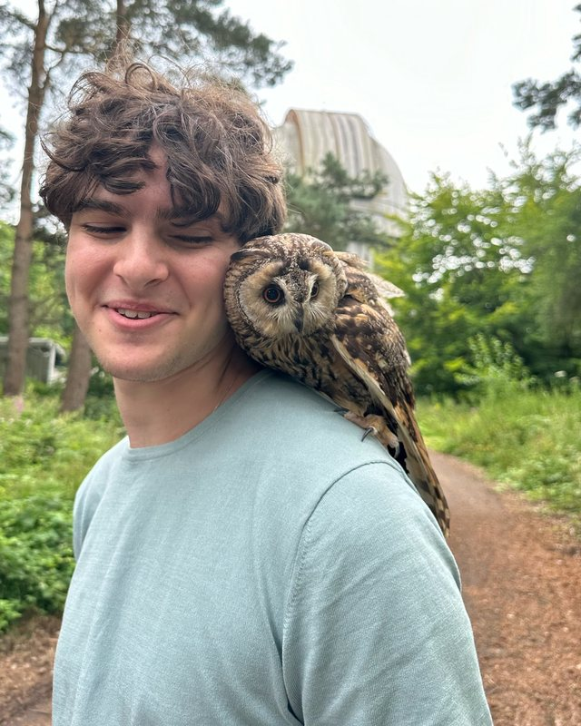

<!-- ## Info -->

::: {.subtitle-lines}
Undergraduate math major\
Department of Mathematics, University of Maryland\
yamit \| at \| umd \| dot \| edu\
[CV](/cv/cv.pdf){target="_blank"} (Last updated Oct 3, 2026)
:::

<!-- yamit X umd Y edu, where
X = an acronym for "algebraic topology", and
Y = the derivative notation of a physicist. -->

## About Me

:::: {.about}

::: {.about-text}
I am a fourth-year mathematics student at the University of Maryland (UMD).
My primary interests are algebraic number theory and arithmetic geometry.

Outside of math, I enjoy watching theater (*Cabaret*, *Falsettos*), endlessly customizing my
LaTeX template ([yalatex](https://github.com/YuvalAmit2/yalatex)), playing board games
(*Ticket to Ride*, *Set*), and editing Wikipedia.
:::

::: {.about-photo}
{fig-alt="Yuval with an owl perched on his shoulder"}
:::

::::
